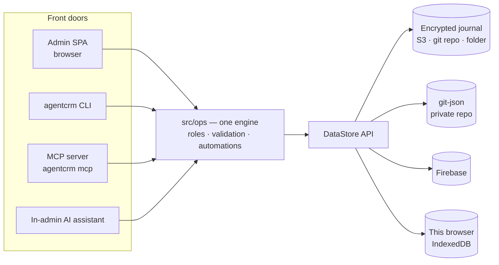

<p align="center">
  <strong>AgentCRM — the static CRM your AI agent can run.</strong><br>
  A HubSpot / Twenty-style CRM that runs entirely in the browser, keeps your contacts encrypted on storage <i>you</i> own,<br>
  and exposes every action to AI agents through a CLI, skills and an MCP server. No server of ours, ever.
</p>

<p align="center">
  <a href="https://www.npmjs.com/package/@fleox-agent-crm/agentcrm"></a>
  <a href="https://github.com/fleox/agentcrm/actions/workflows/ci.yml"></a>
  <a href="#claude-code"></a>
  <a href="#mcp-server"></a>
  <a href="LICENSE"></a>
</p>

<p align="center">
  <a href="#quick-start">Quick start</a> ·
  <a href="#features">Features</a> ·
  <a href="#how-it-works">How it works</a> ·
  <a href="#cli">CLI</a> ·
  <a href="#mcp-server">MCP</a> ·
  <a href="docs/README.md">Docs</a> ·
  <a href="changelog.json">Changelog</a>
</p>

---

## Why AgentCRM

| | |
|---|---|
| **Nothing to run** | The admin is a static web app (HTML + JS) you host anywhere — an S3 bucket, GitHub / GitLab / Cloudflare Pages, a folder. There is no AgentCRM server, account or subscription. |
| **Your data, encrypted, where you choose** | Contacts live in an **encrypted journal** (AES-256-GCM) on *your* S3-compatible bucket, private GitHub / GitLab repo or local folder — or in your own Firebase project. Nobody else can read them, not even us. |
| **Agent-native** | Everything the admin does is a CLI command with JSON output, a tool of the MCP server and of the in-admin assistant. Ask *"review my pipeline and draft follow-ups for the stale deals"* — your agent runs the same engine, with the same roles and validation. |

## Quick start

### With an AI agent

<a id="claude-code"></a>**Claude Code** — install the plugin, then just ask:

```text
/plugin marketplace add fleox/agentcrm
/plugin install agentcrm@agentcrm
```

> *"Install AgentCRM for my company, data in my OVH bucket, admin on GitHub Pages."*

The `agentcrm-install` skill asks where the data lives, then where the admin is hosted, guides you through creating least-privilege keys (you type secrets in your own terminal — never in the chat), writes the install plan, installs and verifies with `doctor`. Other skills: `agentcrm-manage` (health, updates), `agentcrm-admin` (run the CRM), `agentcrm-sales` (pipeline reviews, follow-ups, lead qualification, weekly report), `agentcrm-extensions` (build, test and install modules and themes).

**Other agents** (Codex, Cursor, Hermes…): the skills in [`plugin/skills/`](plugin/skills) are plain Markdown; Hermes gets generated skills with a Python wrapper in [`hermes/`](hermes).

### By hand

```bash
npx -y @fleox-agent-crm/agentcrm@0.12.0 options                         # backends, locations, hostings, plan format
npx -y @fleox-agent-crm/agentcrm@0.12.0 credentials set s3:main          # hidden prompt
npx -y @fleox-agent-crm/agentcrm@0.12.0 install --plan plan.json --dry-run
npx -y @fleox-agent-crm/agentcrm@0.12.0 install --plan plan.json
npx -y @fleox-agent-crm/agentcrm@0.12.0 doctor --site acme
```

Or try it without any account: `npx -y @fleox-agent-crm/agentcrm@0.12.0 serve` opens the setup wizard; pick **This browser** (optionally with demo data).

## Features

- **Records** — companies, people, deals and **custom objects** with 20 field types (select, multi-select, currency, relation one / many, user, rating, address, tags, image, files…); table views with inline edit, filters, sorts, saved views; **kanban** by stage; record pages with relations both ways, timeline, tasks and notes.
- **Images & attachments** — contact photos and company logos (crop, drag & drop) shown everywhere; attach images, PDFs and documents to notes, tasks, calls, emails, meetings and records (button, drag & drop, paste), inline images in Markdown, lightbox, a Files tab per record. Files live next to your data — **encrypted with the same passphrase** on your bucket / repo / folder, in IndexedDB, or in your Firebase Storage — and are erased physically by `compact`. See [docs/files.md](docs/files.md).
- **Pipelines** — multiple pipelines, stages with probability and open / won / lost kinds, weighted forecast.
- **Activities & tasks** — notes (Markdown), calls, emails, meetings, tasks with due dates and assignees; Gmail / Google Calendar / Outlook logging from the browser (OAuth, no server).
- **Automations** — triggers on create / update / field change / stage change / schedule / inactivity; actions create task, update field, add note, assign owner (round robin), webhook. Scheduled ones run from the open admin or a [GitHub Actions cron](docs/automations.md).
- **Lead forms** — a static form page posting to an inbox you own (S3 prefix, Firestore, or your webhook); submissions become deduped records.
- **Import / export** — CSV import with automatic mapping, coercion, dedupe (email / domain) and a dry-run report; CSV / JSON export; ZIP backup with every file.
- **Reports** — pipeline by stage, forecast, won / lost, activity per user, lead sources, stale deals, conversion funnel.
- **Roles** — admin / member / viewer, enforced in the engine (and by Firestore rules in Firebase mode).
- **AI assistant** — in the admin, with your own Claude API key, driving the same tool catalog as the MCP server.
- **GDPR** — soft delete + `compact` for physical erasure; encrypted by default; export everything.
- **Customisation** — switch modules off, install extension modules and themes at runtime, brand the look (accent, grays, font, density, logo, custom CSS) — by hand or by asking your AI agent. See below.

## Customisation

Everything you can customise in the admin, an AI agent can do too (CLI, MCP tools, skills) — same engine, same permissions (admins only for workspace-wide changes), and every change shows a plan before it is applied.

### Modules — keep only what you use

Settings → **Modules** switches built-in features off for the whole workspace: dashboard, deals & pipelines, reports, lead forms, tasks, automations, email & calendar, AI assistant. Disabling hides pages, navigation, widgets and owned objects; it never deletes data. Dependencies are checked (cascade on request). [docs/modules.md](docs/modules.md)

```bash
npx -y @fleox-agent-crm/agentcrm@0.12.0 modules list --site acme
npx -y @fleox-agent-crm/agentcrm@0.12.0 modules disable forms --site acme --yes
```

### Appearance — make it yours

Settings → **Appearance**: one accent color generates the whole palette; neutral grays, radius, density, font (system or Google fonts), sidebar style, accent or neutral buttons, high contrast, default light / dark mode, logo, favicon, custom CSS, seven presets (default, ocean, forest, sunset, graphite, rose, high-contrast) and theme extensions. [docs/appearance.md](docs/appearance.md)

```bash
npx -y @fleox-agent-crm/agentcrm@0.12.0 appearance set --accent "#0f766e" --neutral stone --buttons accent --site acme --yes
npx -y @fleox-agent-crm/agentcrm@0.12.0 appearance logo ./logo.svg --site acme --yes
npx -y @fleox-agent-crm/agentcrm@0.12.0 appearance preset ocean --site acme --yes
```

### Extensions — add features without rebuilding

Modules (pages, record tabs, dashboard widgets, settings pages, AI tools, automation actions, hooks) and themes are ZIPs installed from Settings → Modules → **Installed extensions** or the CLI, stored in the CRM's own data and loaded at runtime by every admin — and by the CLI / MCP server, so their AI tools and automation actions work there too. Installing runs code with admin rights: the admin and the CLI always show who made it and what it adds first; safe mode (`?safe=1`, or `--safe`) starts without extensions. [docs/extensions.md](docs/extensions.md)

```bash
npx -y @fleox-agent-crm/agentcrm@0.12.0 ext new module acme-projects     # scaffold (Vite + typings + en/fr)
cd acme-projects && npm install && npm run build
npx -y @fleox-agent-crm/agentcrm@0.12.0 ext check .                      # validate + load it like the admin
npx -y @fleox-agent-crm/agentcrm@0.12.0 ext install . --site acme --yes  # install (plan without --yes)
```

Guides: [creating a module](docs/creating-a-module.md), [creating a theme](docs/creating-a-theme.md), [runtime API reference](docs/runtime-api-reference.md). Examples: [`external/`](external).

### Ask your agent

With the AgentCRM skills installed (Claude Code plugin or Hermes), just say:

- *"We don't use deals or lead forms — hide what we don't need."*
- *"Make the CRM look like our brand: here's our logo."* / *"Use #e4002b as the main color with a dark sidebar."*
- *"Install the sales-goals extension from my Downloads folder."* (the agent shows the plan and asks first)
- *"Build a module that adds a Renewals page and a tool to list deals renewing in the next 60 days, then install it."*
- *"Turn off the extension that broke the dashboard."*

## How it works



All business logic lives in `src/ops/`. The admin, the CLI, the MCP server and the assistant are four front doors to it, so an agent can do exactly what a user can do — no more (roles apply), no less. The journal backend appends one encrypted segment per write (no lock, no conflict between users) and merges them per field with hybrid logical clocks; `compact` folds them into a snapshot. See [docs/architecture.md](docs/architecture.md).

## Data backends

| Backend | Where | Good for | Encrypted | Multi-user |
|---|---|---|---|---|
| `journal` (default) | S3-compatible bucket, private GitHub / GitLab repo, local folder | Most teams; personal data under your control | Yes (AES-256-GCM, PBKDF2 600k) | Yes, conflict-free |
| `git-json` | Private GitHub / GitLab repo, one JSON file per record | Readable history, per-user tokens | No (history keeps old values) | Yes |
| `firebase` | Your Firebase project (Firestore + Auth) | Real-time teams with logins | At rest by Google | Yes, roles in rules |
| `local` | This browser (IndexedDB) | Trying it | — | No |

## Hosting the admin

S3 / R2 / OVH / Scaleway buckets (HTTPS), GitHub Pages, GitLab Pages, Cloudflare Pages, a local folder, or a ZIP to upload anywhere. The admin holds no data and its `config.js` never contains a secret. See [docs/hosting.md](docs/hosting.md).

## CLI

`agentcrm` runs on Node.js 20+ (`npx -y @fleox-agent-crm/agentcrm@0.12.0 <command>`). Every command accepts `--json` and prints exactly one `{ ok, data }` / `{ ok: false, error: { code, message, hint } }` object; destructive commands print a plan unless `--yes`.

| Area | Commands |
|---|---|
| Setup | `status`, `options`, `credentials set\|list\|remove\|copy\|verify`, `install --plan`, `site list\|add\|use\|rename\|forget\|credentials`, `doctor`, `serve`, `deploy-admin` |
| Records | `records list\|get\|create\|update\|delete\|restore\|search\|duplicates\|merge` |
| Schema | `objects list\|get\|create\|update\|delete`, `fields add\|update\|delete` |
| Work | `activities add\|list\|done`, `notes add`, `tasks list\|add\|done\|reassign`, `pipelines list\|move` |
| Admin | `views list\|create\|delete`, `users list\|add\|role\|disable`, `settings get\|set` |
| Data | `import csv`, `export csv\|json`, `report <name>`, `stats`, `compact` |
| Automation | `automations list\|enable\|disable\|run`, `forms list\|publish\|ingest` |
| Customisation | `modules list\|get\|enable\|disable\|config`, `appearance get\|presets\|set\|preset\|logo\|favicon\|css\|reset`, `ext new\|check\|pack\|install\|list\|enable\|disable\|uninstall\|export` |
| AI | `tools list\|call`, `mcp` |

Full reference: [docs/cli.md](docs/cli.md).

## MCP server

```bash
claude mcp add agentcrm -- npx -y @fleox-agent-crm/agentcrm@0.12.0 mcp --site acme
```

Tools = the shared AI catalog (search, list, get, create, update, delete, merge records, notes, activities, tasks, deal stages, reports, CSV import, automations…), resources = schema, pipelines, modules and appearance, plus the tools of the site's enabled extension modules; prompts = pipeline review, follow-up email, lead qualification. `--read-only` hides every tool that writes. Claude Desktop / Cursor config: [docs/mcp.md](docs/mcp.md).

## AI assistant

The admin has a chat panel that calls the Claude API **from your browser** with your own key, using the same tools as the MCP server. Mutating tools ask for confirmation.

## Automations without a server

Event automations run wherever a write happens (browser, CLI, MCP). Time-based ones (schedule, inactivity) and lead form ingestion run while the admin is open, or from a scheduled GitHub Actions workflow in a private repo of yours: [docs/automations.md](docs/automations.md) and [the template](docs/templates/agentcrm-cron.yml).

## Security & GDPR

- **Secrets never leave the browser / the CLI credentials file** (`~/.agentcrm/credentials.json`, mode 0600): never in `config.js`, the data, git, or a chat.
- **Encrypted by default**: passphrase → PBKDF2-SHA256 (600 000 iterations) → AES-256-GCM; gzip before encryption.
- **Right to erasure**: deleted records are purged physically by `compact` (journal: a new snapshot, old segments deleted). git-json keeps history — documented and warned.
- **Least privilege**: keys scoped to the CRM buckets / repos; roles enforced in the engine.
- See [SECURITY.md](SECURITY.md).

## Compared with…

| | AgentCRM | Twenty | HubSpot | A spreadsheet |
|---|---|---|---|---|
| Server to run | None | Postgres + Node server (self-host) or their cloud | Their cloud | None |
| Where the data lives | Your bucket / repo / Firebase, encrypted | Your DB or their cloud | Their cloud | A file |
| Cost | Your storage (often cents) | Hosting / seats | Seats, tiers | Free |
| AI agents | CLI + skills + MCP + assistant, same engine | API | API, paid AI | Ad hoc |
| Pipelines, automations, forms | Yes | Yes | Yes | Manual |
| Scale | Small & medium teams (whole dataset in memory) | Large | Large | Small |

## Development

```bash
npm install --legacy-peer-deps
npm run dev          # admin at http://localhost:5180
npm run typecheck && npm test && npm run build
node dist/agent/agentcrm.mjs help
```

Contributing: [CONTRIBUTING.md](CONTRIBUTING.md); maintenance rules for agents: [AGENTS.md](AGENTS.md).

## License

[PolyForm Noncommercial 1.0.0](LICENSE). Personal, educational, research and other noncommercial use is free; commercial use requires written authorization — open an issue.
