<p align="center">
  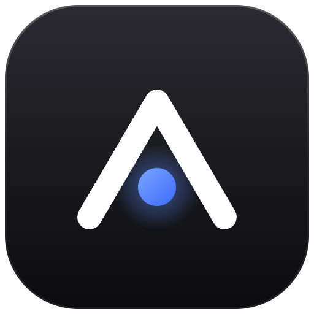
</p>

<h1 align="center">AgentCRM</h1>

<p align="center">
  <strong>The static CRM your AI agent can run.</strong><br>
  Companies, people, deals, pipelines, tasks and reports in a browser admin.<br>
  Your contacts stay encrypted on storage you own. No server to run, ever.
</p>

<p align="center">
  <a href="https://www.npmjs.com/package/@fleox-agent-crm/agentcrm"></a>
  <a href="https://github.com/fleox/agentcrm/actions/workflows/ci.yml"></a>
  <a href="https://www.npmjs.com/package/@fleox-agent-crm/agentcrm"></a>
  <a href="#claude-code"></a>
  <a href="#mcp-server"></a>
  <a href="https://github.com/fleox/agentcrm/blob/master/LICENSE"></a>
</p>

<p align="center">
  <a href="#quick-start">Quick start</a> ·
  <a href="#features">Features</a> ·
  <a href="#make-it-yours">Make it yours</a> ·
  <a href="#how-it-works">How it works</a> ·
  <a href="#the-agentcrm-cli">CLI</a> ·
  <a href="#mcp-server">MCP</a> ·
  <a href="https://github.com/fleox/agentcrm/blob/master/docs/README.md">Docs</a> ·
  <a href="https://github.com/fleox/agentcrm/blob/master/changelog.json">Changelog</a>
</p>

<p align="center">
  <a href="https://cdn.jsdelivr.net/gh/fleox/agentcrm@master/.github/assets/agentcrm-demo.mp4">
    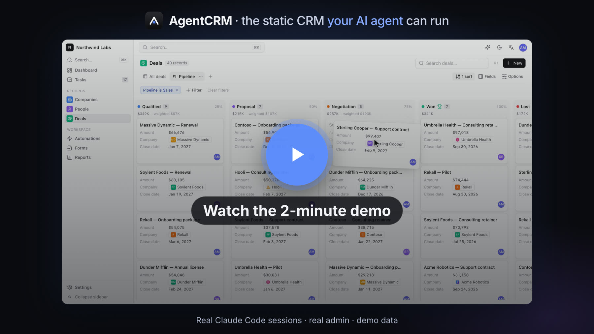
  </a>
  <br><sub>▶️ <a href="https://cdn.jsdelivr.net/gh/fleox/agentcrm@master/.github/assets/agentcrm-demo.mp4">Watch the 2-minute demo</a>: Claude Code installs the CRM, imports leads, moves a deal and plans the follow-ups, then a tour of the admin.</sub>
</p>

---

## Why AgentCRM

<table>
<tr>
<td width="33%" valign="top">
<h3>🗂️ Nothing to run</h3>
<p>The admin is a static web app: HTML and JavaScript you host anywhere, for free or nearly (GitHub, GitLab or Cloudflare Pages, an S3 bucket, a folder). There is no AgentCRM server, account or subscription, and nothing to patch.</p>
</td>
<td width="33%" valign="top">
<h3>🔐 Your contacts, encrypted, where you choose</h3>
<p>Data lives in an <b>encrypted journal</b> (AES-256-GCM) on <i>your</i> S3-compatible bucket, private GitHub / GitLab repo or local folder, or in your own <b>Firebase</b> project. Several people can work at once without conflicts, and erasure is physical.</p>
</td>
<td width="33%" valign="top">
<h3>🤖 Agent-native</h3>
<p>Every action of the admin is also a CLI command with JSON output, an MCP tool and a tool of the in-admin assistant, with ready-made skills for Claude Code and Hermes. Ask <i>"move Globex to negotiation and plan the follow-ups"</i>: your agent runs the same engine, with the same roles and checks.</p>
</td>
</tr>
</table>

## Quick start

### With an AI agent

<a id="claude-code"></a>**Claude Code**

```text
/plugin marketplace add fleox/agentcrm
/plugin install agentcrm@agentcrm
```

Then just ask:

> *Install AgentCRM for my company: data in my OVH bucket, admin on GitHub Pages.*<br>
> *Import the leads in ~/Downloads/leads.csv, skip duplicates, and create a follow-up task for each one.*<br>
> *Which deals have had no activity for two weeks? Draft a follow-up email for each.*

The agent asks where the data lives and where the admin is hosted, then walks you through creating least-privilege keys. You type secrets in your own terminal, never in the chat.

<p align="center">
  
  <br><sub>A real Claude Code session. The agent's work is sped up ×8 (labelled); typing and the answer play in real time. It ends on the admin opening that same encrypted data.</sub>
</p>

Once it is installed, the CRM is a conversation:

<p align="center">
  
  <br><sub>Same CRM, a second request: import, pipeline move, follow-up tasks and a forecast. Sped up ×16 while the agent works.</sub>
</p>

<details>
<summary><b>And a third one: <i>"Make the CRM match our brand…"</i></b></summary>
<p align="center">
  
  <br><sub>Appearance and modules changed by the agent through the same engine as Settings. Sped up ×8.</sub>
</p>
</details>

| Agent | Setup |
|---|---|
| **Claude Code** | the plugin above: skills `agentcrm-install`, `agentcrm-manage`, `agentcrm-admin`, `agentcrm-sales`, `agentcrm-extensions` |
| **Claude Desktop, Cursor, any MCP client** | the [MCP server](#mcp-server): `agentcrm mcp --site <alias>` |
| **Hermes Agent** / Python agents | generated skills with a Python wrapper, see [hermes/](https://github.com/fleox/agentcrm/tree/master/hermes) |
| **Codex, Windsurf, any other agent** | point it at [AGENTS.md](https://github.com/fleox/agentcrm/blob/master/AGENTS.md) and the Markdown skills in [plugin/skills/](https://github.com/fleox/agentcrm/tree/master/plugin/skills) |

### Without an agent

```bash
npx -y @fleox-agent-crm/agentcrm@0.12.2 serve
```

This starts the admin on your computer (Node.js 20+). Open the printed URL and follow the setup wizard: **data → where → install**. To look around first, pick **This browser** with demo data: nothing leaves your machine. The wizard can also put the admin on GitHub / GitLab / Cloudflare Pages or a bucket, so your team only needs a browser.

Scripted installs (`install --plan plan.json`), hosting options and Firebase are in [docs/hosting.md](https://github.com/fleox/agentcrm/blob/master/docs/hosting.md) and [docs/cli.md](https://github.com/fleox/agentcrm/blob/master/docs/cli.md).

## Features

<p align="center">
  <picture>
    <source media="(prefers-color-scheme: dark)" srcset="https://raw.githubusercontent.com/fleox/agentcrm/master/.github/assets/admin-dashboard-dark.jpg">
    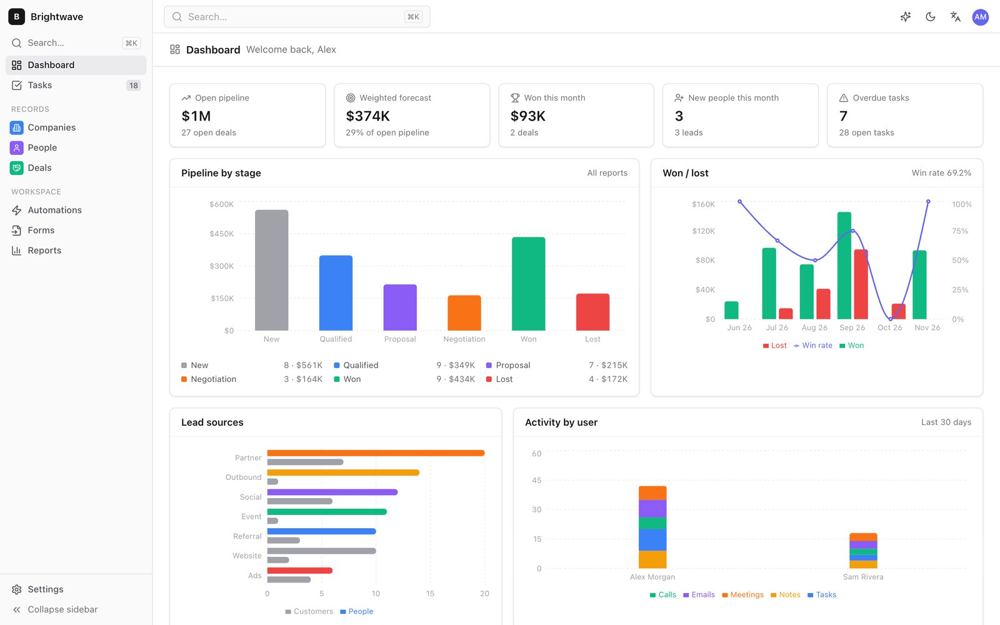
  </picture>
</p>

<table>
<tr>
<td width="50%">
  <picture>
    <source media="(prefers-color-scheme: dark)" srcset="https://raw.githubusercontent.com/fleox/agentcrm/master/.github/assets/admin-kanban-dark.jpg">
    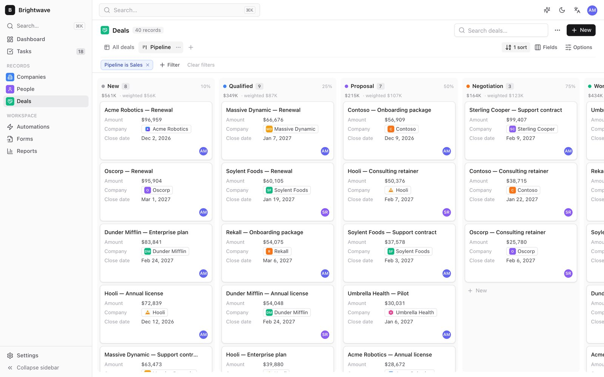
  </picture>
  <p align="center"><b>Pipelines</b>: drag deals between stages, weighted forecast</p>
</td>
<td width="50%">
  <picture>
    <source media="(prefers-color-scheme: dark)" srcset="https://raw.githubusercontent.com/fleox/agentcrm/master/.github/assets/admin-record-dark.jpg">
    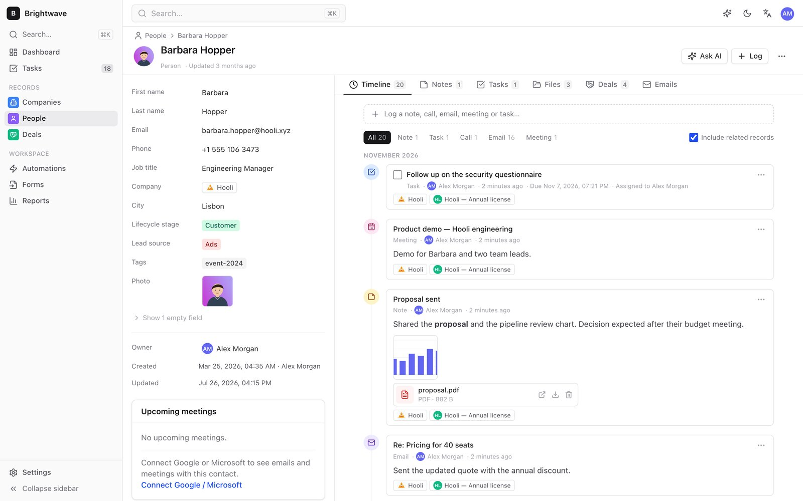
  </picture>
  <p align="center"><b>Record pages</b>: fields, relations, timeline, files</p>
</td>
</tr>
<tr>
<td width="50%">
  <picture>
    <source media="(prefers-color-scheme: dark)" srcset="https://raw.githubusercontent.com/fleox/agentcrm/master/.github/assets/admin-table-dark.jpg">
    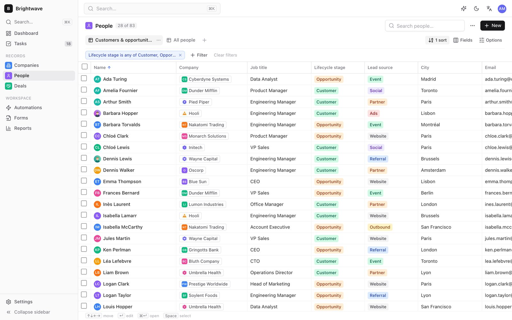
  </picture>
  <p align="center"><b>Tables</b>: inline edit, filters, saved views, bulk actions</p>
</td>
<td width="50%">
  <picture>
    <source media="(prefers-color-scheme: dark)" srcset="https://raw.githubusercontent.com/fleox/agentcrm/master/.github/assets/admin-search-dark.jpg">
    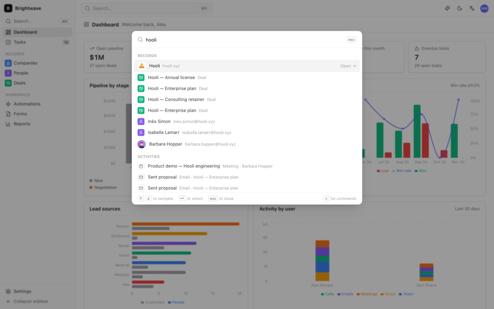
  </picture>
  <p align="center"><b>Cmd+K</b>: search everything, jump anywhere</p>
</td>
</tr>
</table>

**Sell**
- Companies, people, deals and **custom objects** with 20 field types (currency, relation one / many, select, user, rating, address, image, files…)
- Several **pipelines** with probabilities and open / won / lost stages, kanban by stage, weighted forecast
- Notes in Markdown, calls, emails, meetings and **tasks** with due dates and assignees; Gmail, Google Calendar and Outlook logging from the browser (OAuth, no server)
- Contact photos, company logos and attachments on records and activities, stored with your data and encrypted with it

**Organise**
- Table views with inline edit, filters, sorts, saved views and bulk actions; each user's layout follows them across devices
- **Drilldown** and **rollup** fields: a market's company count links to those companies, a company's status is recomputed for the markets you filtered on
- Duplicate detection and merge, CSV import with automatic mapping and a dry run, CSV / JSON export, full ZIP backup
- **Who changed what**: every record keeps who last wrote each field and when, from the admin, the CLI, imports and syncs

**Automate and report**
- **Automations** on create, update, field change, stage change, schedule or inactivity: create a task, update a field, add a note, assign an owner (round robin), call a webhook
- **Lead forms**: a static form page that posts to an inbox you own; submissions become deduplicated records
- **Reports**: pipeline by stage, forecast, won / lost, activity per user, lead sources, stale deals, conversion
- Scheduled work runs while the admin is open, or from a [GitHub Actions cron](https://github.com/fleox/agentcrm/blob/master/docs/automations.md) in a private repo of yours

**Run it as code**
- **Schema as code**: objects, fields, pipelines and views in one JSON file, applied with a plan, idempotent, never destructive ([guide](https://github.com/fleox/agentcrm/blob/master/docs/schema-as-code.md))
- **Mirror another system**: `records sync` keeps an object in step with an external source by key, archives what left, writes only the differences ([guide](https://github.com/fleox/agentcrm/blob/master/docs/sync.md))

**Safe by design**
- Encrypted by default: passphrase → PBKDF2-SHA256 (600 000 iterations) → AES-256-GCM
- Secrets (storage keys, git tokens, passphrases) stay in each user's browser or in the CLI's `0600` credentials file, never in `config.js`, the data or git
- Admin, member and viewer roles, enforced by the engine itself (and by generated Firestore rules in Firebase mode)
- GDPR: soft delete, then `compact` erases deleted records and files physically; export everything at any time
- The admin is available in English and French

## Make it yours

Everything below is in **Settings**, and an agent can do all of it too (CLI, MCP tools, skills), with a plan before any change.

**Appearance.** One accent colour generates the whole palette. Pick the grays, radius, density, font, sidebar style, dark or light by default, your logo and favicon, custom CSS, or one of the presets and theme extensions. [Appearance guide](https://github.com/fleox/agentcrm/blob/master/docs/appearance.md)

<table>
<tr>
<td width="25%">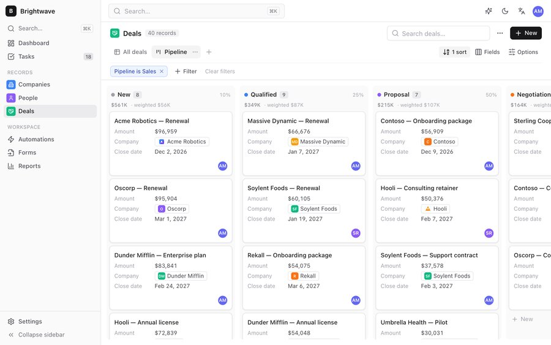<p align="center">Default</p></td>
<td width="25%">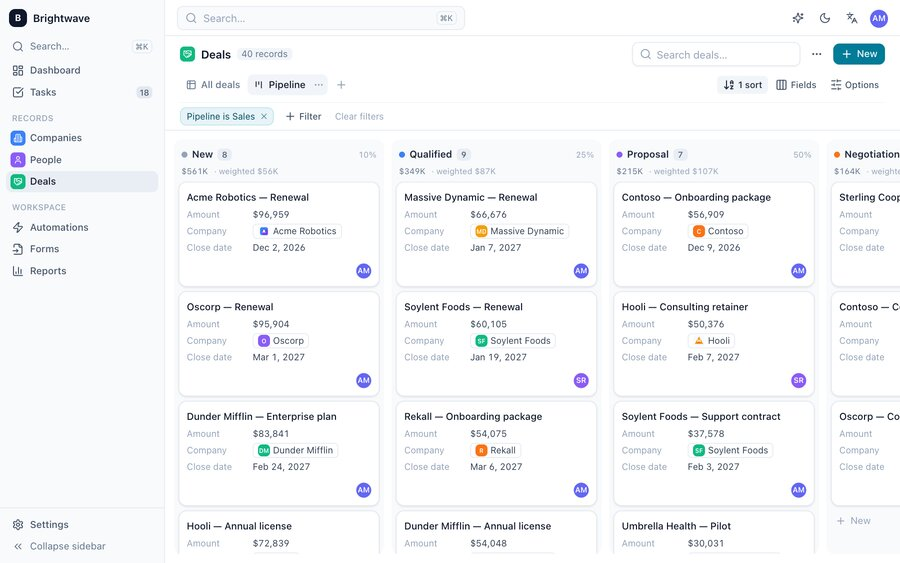<p align="center">Ocean</p></td>
<td width="25%">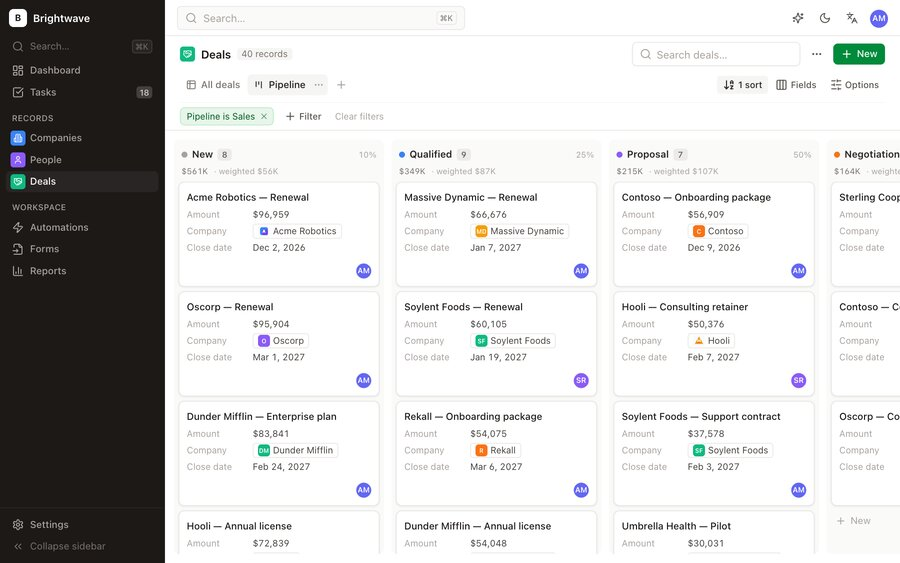<p align="center">Forest</p></td>
<td width="25%">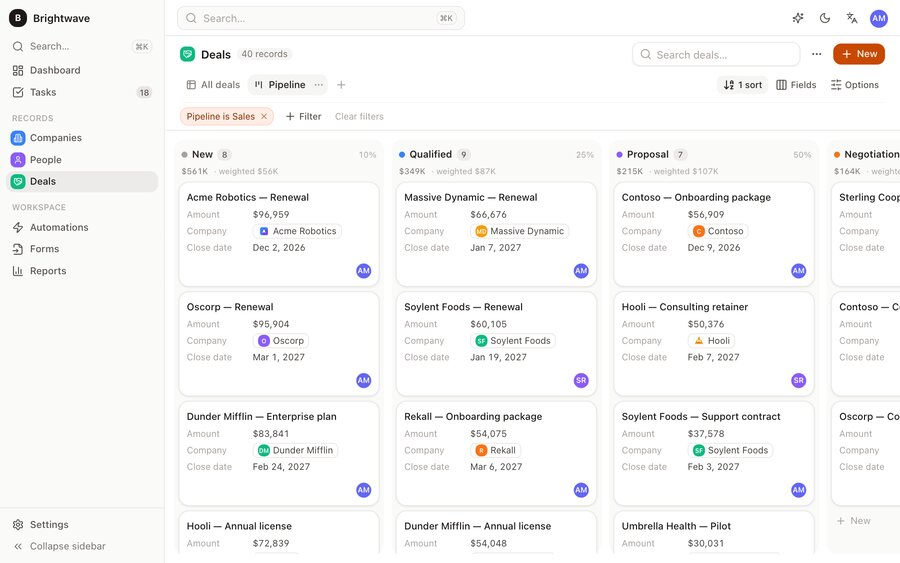<p align="center">Sunset</p></td>
</tr>
<tr>
<td width="25%">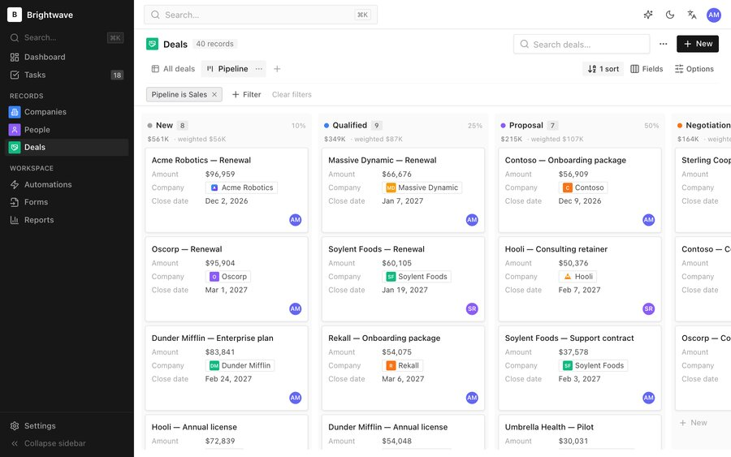<p align="center">Graphite</p></td>
<td width="25%">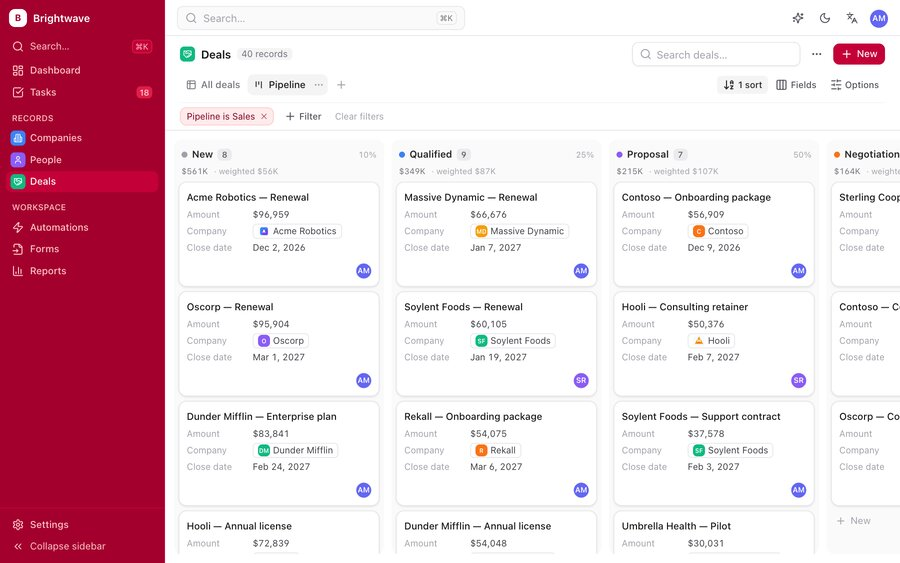<p align="center">Rose</p></td>
<td width="25%">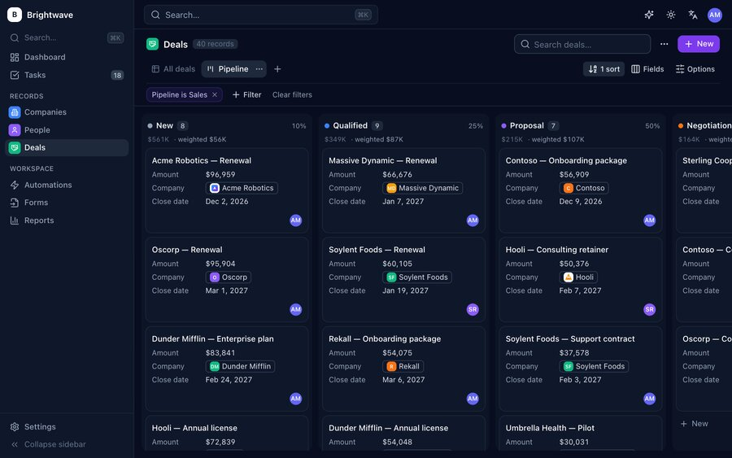<p align="center">Midnight (theme extension)</p></td>
<td width="25%">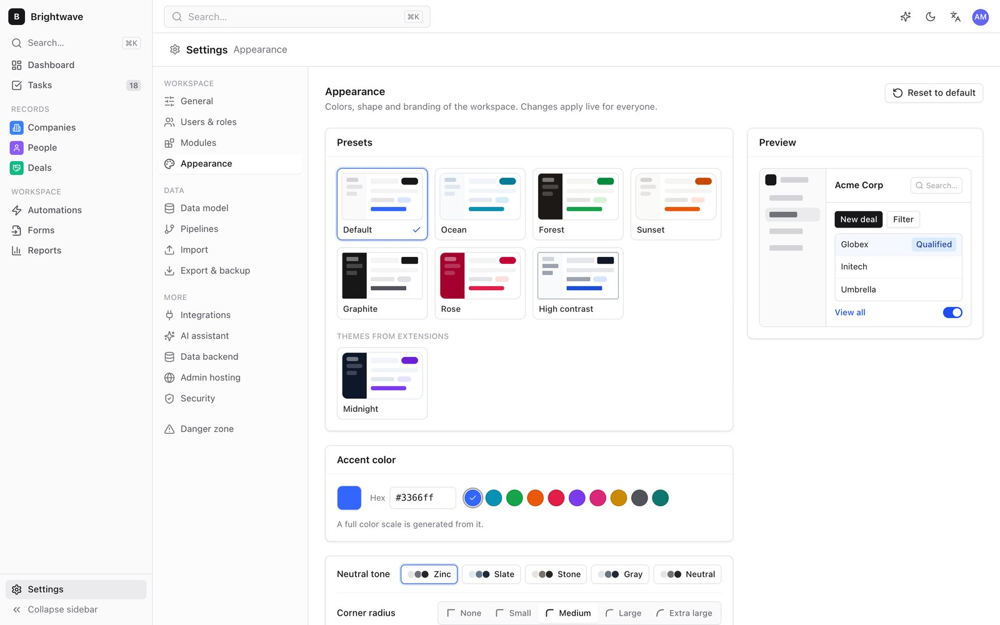<p align="center">Settings → Appearance</p></td>
</tr>
</table>

**Modules.** Switch off what you don't use (dashboard, deals and pipelines, reports, lead forms, tasks, automations, email and calendar, AI assistant). Pages, navigation and widgets disappear; no data is deleted. [Modules guide](https://github.com/fleox/agentcrm/blob/master/docs/modules.md)

**Extensions.** Modules (pages, record tabs, dashboard widgets, settings pages, AI tools, automation actions, hooks) and themes are ZIP files installed at runtime, with no rebuild. They are stored in the CRM's own data, so every admin, the CLI and the MCP server load them. Installing shows who made it and what it adds, and safe mode starts without any. [Extensions guide](https://github.com/fleox/agentcrm/blob/master/docs/extensions.md)

```bash
npx -y @fleox-agent-crm/agentcrm@0.12.2 ext new module deal-radar   # Vite project, typings, en / fr
cd deal-radar && npm install && npm run build
npx -y @fleox-agent-crm/agentcrm@0.12.2 ext check .                 # validates it and loads it like the admin
npx -y @fleox-agent-crm/agentcrm@0.12.2 ext install . --site acme   # plan; add --yes to install
```

<p align="center">
  
  <br><sub>The module's AI tool is live right away in the CLI, the MCP server and the in-admin assistant.</sub>
</p>

Guides: [creating a module](https://github.com/fleox/agentcrm/blob/master/docs/creating-a-module.md) · [creating a theme](https://github.com/fleox/agentcrm/blob/master/docs/creating-a-theme.md) · [runtime API](https://github.com/fleox/agentcrm/blob/master/docs/runtime-api-reference.md) · [examples](https://github.com/fleox/agentcrm/tree/master/external). With Claude Code, the `agentcrm-extensions` skill drives the whole loop.

## How it works

<p align="center">
  <picture>
    <source media="(prefers-color-scheme: dark)" srcset="https://raw.githubusercontent.com/fleox/agentcrm/master/.github/assets/how-it-works-dark.png">
    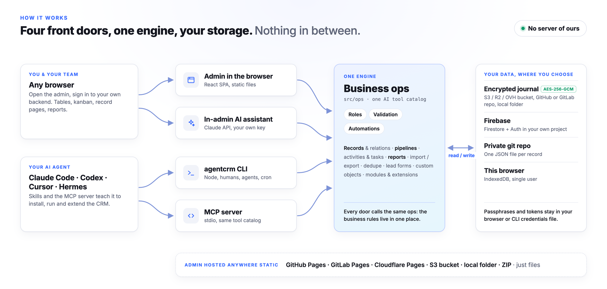
  </picture>
</p>

All business rules live in one engine. The admin, the CLI, the MCP server and the assistant are four front doors to it, so an agent can do exactly what a user can do: no more (roles apply), no less. The **data backend** (where the CRM lives) and the **hosting** (where the admin is served) are independent choices.

| Data backend | Where | Good for | Encrypted | Several users |
|---|---|---|---|---|
| **Encrypted journal** *(default)* | S3-compatible bucket (AWS, R2, OVH, Scaleway…), private GitHub / GitLab repo, local folder | Most teams: personal data under your control | Yes | Yes, conflict-free |
| **Firebase** | Firestore + Auth in your own project | Real-time teams with logins; incremental loading fits the free plan | At rest by Google | Yes, roles in generated rules |
| **Private git repo (JSON)** | One readable JSON file per record | Readable history, per-user tokens | No (history keeps old values) | Yes |
| **This browser** | IndexedDB | Trying it out | — | No |

The journal appends one encrypted segment per write, with no lock, and merges them field by field with hybrid logical clocks; `compact` folds them into a snapshot and erases what was deleted. The admin itself goes on **GitHub Pages**, **GitLab Pages**, **Cloudflare Pages**, an **S3-compatible bucket**, a local folder or a ZIP; its `config.js` never holds a secret. See [architecture](https://github.com/fleox/agentcrm/blob/master/docs/architecture.md), [hosting](https://github.com/fleox/agentcrm/blob/master/docs/hosting.md) and [Firebase](https://github.com/fleox/agentcrm/blob/master/docs/firebase.md).

## How AgentCRM compares

| | AgentCRM | Twenty | HubSpot | A spreadsheet |
|---|---|---|---|---|
| Server or database to run | ❌ none | ✅ Postgres + Node (or their cloud) | their cloud | ❌ none |
| Where the data lives | your bucket / repo / Firebase, encrypted | your database or their cloud | their cloud | a file |
| Cost | your storage, often cents | hosting or seats | seats and tiers | free |
| Pipelines, automations, forms, reports | ✅ | ✅ | ✅ | manual |
| Fully drivable by an AI agent | ✅ CLI, MCP, skills, assistant | API | API, paid AI | ad hoc |
| Scale | small and medium teams (whole dataset in memory) | large | large | small |

## The `agentcrm` CLI

The same engine the agents use, by hand: `npx -y @fleox-agent-crm/agentcrm@0.12.2 help`. Every command accepts `--json` and prints exactly one `{ ok, data }` or `{ ok: false, error }` object, and commands that change the workspace print a plan until you add `--yes`.

<p align="center">
  
  <br><sub>Run the CRM from a terminal or a script, on the same data as the admin.</sub>
</p>

Describe the data model in a file and keep an object in step with another system:

<p align="center">
  
  <br><sub><code>schema apply</code> and <code>records sync</code>: plan first, idempotent, nothing deleted.</sub>
</p>

<details>
<summary><b>All commands</b></summary>

| Area | Commands |
|---|---|
| Setup | `status`, `options`, `credentials set\|list\|remove\|copy\|verify\|types`, `install --plan`, `site list\|show\|add\|use\|rename\|forget\|credentials\|runtime`, `doctor`, `serve`, `deploy-admin` |
| Records | `records list\|get\|create\|update\|delete\|restore\|search\|duplicates\|merge\|image\|sync`, `files list\|upload\|get\|delete\|usage` |
| Schema | `schema apply`, `objects list\|get\|create\|update\|delete`, `fields add\|update\|delete` |
| Work | `activities add\|list\|done`, `notes add`, `tasks list\|add\|done\|reassign`, `pipelines list\|move` |
| Admin | `views list\|create\|delete`, `users list\|add\|role\|disable`, `settings get\|set` |
| Data | `import csv\|zip`, `export csv\|json\|zip`, `report <name>`, `stats`, `compact` |
| Automation | `automations list\|enable\|disable\|run`, `forms list\|publish\|ingest` |
| Customisation | `modules list\|get\|enable\|disable\|config`, `appearance get\|presets\|set\|preset\|logo\|favicon\|css\|reset`, `ext new\|check\|pack\|install\|list\|enable\|disable\|uninstall\|export` |
| AI | `tools list\|call`, `mcp` |

Full reference: [docs/cli.md](https://github.com/fleox/agentcrm/blob/master/docs/cli.md).

</details>

## MCP server

```bash
claude mcp add agentcrm -- npx -y @fleox-agent-crm/agentcrm@0.12.2 mcp --site acme
```

<p align="center">
  
</p>

**Tools** are the shared AI catalog: search, list, get, create, update, delete and merge records, notes, activities, tasks, deal stages, reports, CSV import, automations, modules and appearance, plus the tools of the site's enabled extension modules. **Resources** are the schema, pipelines, modules and appearance. **Prompts** cover a pipeline review, a follow-up email and lead qualification. `--read-only` hides every tool that writes. Claude Desktop and Cursor setup: [docs/mcp.md](https://github.com/fleox/agentcrm/blob/master/docs/mcp.md).

The admin also has an **AI assistant** panel that calls the Claude API from your browser with your own key, with the same tools; tools that write ask for confirmation.

## Documentation

| | |
|---|---|
| [Hosting](https://github.com/fleox/agentcrm/blob/master/docs/hosting.md) | Data backends, storage options, hosting the admin, protecting it |
| [Firebase](https://github.com/fleox/agentcrm/blob/master/docs/firebase.md) | Console setup, generated rules, invitations, CLI sign-in, costs |
| [Data model](https://github.com/fleox/agentcrm/blob/master/docs/data-model.md) | Objects, fields, relations, drilldowns, rollups, pipelines |
| [Schema as code](https://github.com/fleox/agentcrm/blob/master/docs/schema-as-code.md) · [Sync](https://github.com/fleox/agentcrm/blob/master/docs/sync.md) | The data model in a file; mirroring another system |
| [CLI](https://github.com/fleox/agentcrm/blob/master/docs/cli.md) · [MCP](https://github.com/fleox/agentcrm/blob/master/docs/mcp.md) | Every command; MCP clients |
| [Automations](https://github.com/fleox/agentcrm/blob/master/docs/automations.md) · [Import / export](https://github.com/fleox/agentcrm/blob/master/docs/import-export.md) · [Files](https://github.com/fleox/agentcrm/blob/master/docs/files.md) | Triggers and scheduled runs; CSV, JSON, ZIP; images and attachments |
| [Modules](https://github.com/fleox/agentcrm/blob/master/docs/modules.md) · [Appearance](https://github.com/fleox/agentcrm/blob/master/docs/appearance.md) · [Extensions](https://github.com/fleox/agentcrm/blob/master/docs/extensions.md) | Customising the workspace |
| [Architecture](https://github.com/fleox/agentcrm/blob/master/docs/architecture.md) | The engine, the journal, the code layout |
| [AGENTS.md](https://github.com/fleox/agentcrm/blob/master/AGENTS.md) | Instructions for AI agents working on this repository |

## Contributing

Bug reports and ideas are welcome: [open an issue](https://github.com/fleox/agentcrm/issues/new/choose). Read [CONTRIBUTING.md](https://github.com/fleox/agentcrm/blob/master/CONTRIBUTING.md) before opening a pull request. For security issues, follow [SECURITY.md](https://github.com/fleox/agentcrm/blob/master/SECURITY.md) instead of opening a public issue.

```bash
npm install --legacy-peer-deps
npm run dev        # admin at http://localhost:5180
npm test           # Vitest
npm run build      # admin + CLI
```

## License

Source-available under the [PolyForm Noncommercial License 1.0.0](https://github.com/fleox/agentcrm/blob/master/LICENSE). Personal, hobbyist, educational, research and other noncommercial use is free, and you can fork, modify and redistribute under the same terms.

**Commercial use requires written authorization.** This includes selling the software or hosting it as a paid service. For a commercial license, [open an issue](https://github.com/fleox/agentcrm/issues).
